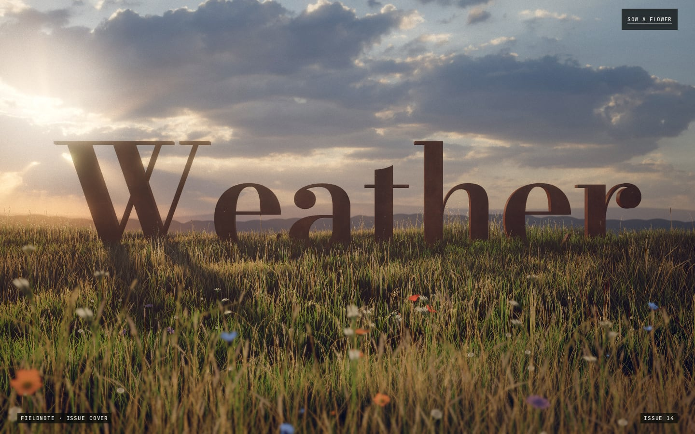
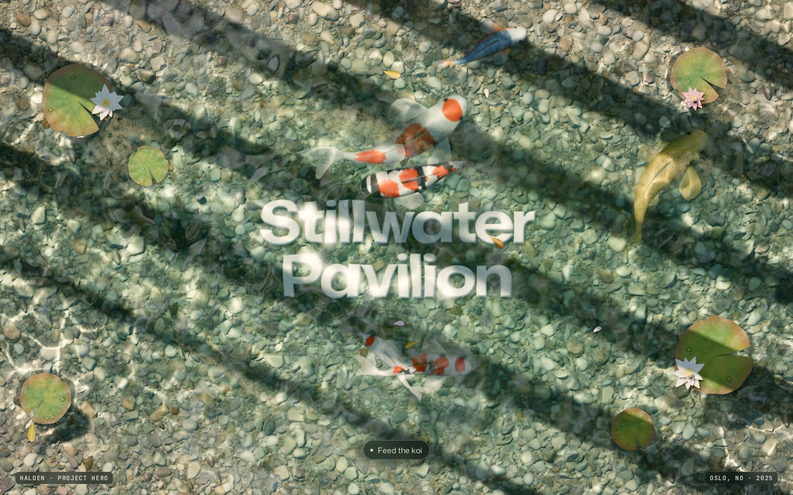
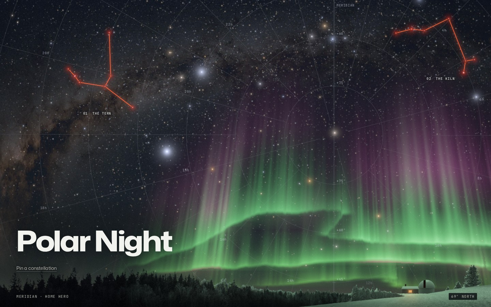

<h1 align="center">Lifelike Heroes</h1>

<p align="center">
  <b>Three living scenes for the top of a website.<br>They look like photographs, and they react when you touch them.</b>
</p>

<p align="center">
  These are not videos. Each scene is drawn live in your browser, dozens of times a second,
  so the grass leans in the wind, the fish come when you feed them, and the sky turns when you drag it.
</p>

<h3 align="center">
  <a href="https://burgisimon.github.io/lifelike-heroes/">Open the live demo →</a>
</h3>

<p align="center">
  <a href="https://burgisimon.github.io/lifelike-heroes/meadow.html">
    
  </a>
</p>

> **What is a "hero"?**
>
> It is the big picture at the very top of a website: the first thing you see.
> This project asks how far that first picture can go. Can it pass for a photograph and still be something you can play with?

<br>

## Three scenes to play with

Free, nothing to install, no sign-up. Open a scene, then move your mouse over it and click.

On a phone you can tap to plant a flower, feed the koi or draw a constellation. The effects that follow the pointer need a mouse or trackpad, so a laptop or desktop shows the scenes at their best.

### 1 &nbsp;·&nbsp; Meadow

This is the picture at the top of this page: a magazine cover for a "Weather" issue. The word stands as steel letters in a field of grass and wildflowers, and the wind never quite stops.

- **Move the mouse through the grass** and it parts around your pointer.
- **Click** to plant a flower. **Hold and drag** to sow a whole row.
- **Wait a moment** and a gust crosses the field, lifting seeds into the light.

**[Open the meadow →](https://burgisimon.github.io/lifelike-heroes/meadow.html)**

<br>

### 2 &nbsp;·&nbsp; Koi pond

<p>
  <a href="https://burgisimon.github.io/lifelike-heroes/koi.html">
    
  </a>
</p>

You are looking straight down into a clear, shallow pond. Sunlight ripples across the pebbles, the roof beams overhead lay bands of shade on the water, and the koi go about their day.

- **Click the water** to drop some food. Rings spread out and the koi race for it.
- **Move the mouse slowly** and the koi nearby swim over to look. **Move it fast** and they dart away.
- **Watch the lily pads** drift when a fish or a ripple nudges them.

**[Open the koi pond →](https://burgisimon.github.io/lifelike-heroes/koi.html)**

<br>

### 3 &nbsp;·&nbsp; Star chart

<p>
  <a href="https://burgisimon.github.io/lifelike-heroes/stars.html">
    
  </a>
</p>

A map of the real northern sky, with the northern lights over a snowy forest. Every star is where it belongs. The constellations are yours to invent.

- **Move the mouse across the stars** and a faint pencil line links the brightest ones nearby.
- **Click** to ink it in as your own constellation. It gets a name, and a shooting star marks the moment.
- **Drag** to turn the whole sky. It keeps gliding after you let go.

**[Open the star chart →](https://burgisimon.github.io/lifelike-heroes/stars.html)**

<br>

## Why it looks real

- **Real ingredients.** The sky over the meadow is a photographed sky. The pond floor is a 3D scan of river pebbles. The star chart draws about 27,000 real stars, each at its true position, brightness and colour, over NASA's map of the Milky Way.
- **Real behaviour.** The ripples are worked out the way real water moves, and light bends through them onto the pebbles. Every grass blade leans with the wind on its own. The koi steer, come closer and take fright.
- **A real camera's habits.** Soft focus on the grass closest to the lens, a glow around the sun, a little film grain. A lens does these things, so the scenes do too.

## Good to know

- **Any modern browser.** Current versions of Chrome, Edge, Firefox and Safari should all work. Testing so far has been in Chrome and Edge.
- **Keyboard friendly.** Each scene has a button for its main action, and it works from the keyboard too.
- **Motion is optional.** If your device is set to reduce motion, you get a calm still picture instead.
- **Slower devices.** The scenes lower their own detail to stay smooth.

<br>

---

<br>

## Under the hood

Everything from here on is for developers.

The three scenes are re-creations of the 2D-canvas heroes *Meadow*, *Koi pond* and *Star chart* from [AwardComponents](https://github.com/BurgiSimon/AwardComponents), rebuilt in WebGL with one goal: photographs you can touch. Behaviour, options and accessibility of the originals are kept.

### Built with

| Part | Built with |
| --- | --- |
| Rendering | [three.js](https://threejs.org) on WebGL 2, with hand-written GLSL shaders |
| Language | Plain JavaScript modules, no framework |
| Build | [Vite](https://vite.dev), one HTML page per scene |
| Hosting | GitHub Pages, deployed by GitHub Actions on every push to `main` |

### How each scene works

**Meadow** (`src/meadow`)
- About 80,000 instanced grass blades and meadow plants (30,000 on the low tier, which touch devices get by default), bent in the vertex shader by a ripple, slanted gust fronts and a spring that follows the pointer.
- A photographed HDRI sky is both the backdrop and the light source. It drifts with the wind, and cloud shadows cross the field.
- The word is real geometry: the outlines of Bodoni Moda, extruded and given a scanned rust material.
- Finished like a photograph: depth of field on the nearest grass, bloom, AgX tone mapping and grain.

**Koi pond** (`src/koi`)
- The water surface is a wave simulation that runs on the GPU. The same surface refracts the pebble floor and focuses the sunlight into caustics.
- Each koi is a chain of joints steered by simple rules: wander, come for food, approach a slow pointer, bolt from a fast one.
- Koi skins are painted scale by scale into a texture when the page loads, after real varieties such as Kohaku, Sanke and Ogon.
- Lily pads, blooms, floating leaves and the shade of the pavilion's roof beams are drawn by shaders.

**Star chart** (`src/stars`)
- A catalogue of 41,411 real stars down to magnitude 8. The roughly 27,000 that rise at 69° north are drawn as points with a lens-like glow and a colour derived from their measured B–V index, on a map centred on the celestial pole. The low tier stops at magnitude 7.2.
- The sky drifts slowly around the pole and can be dragged, with inertia.
- A hover joins the brightest stars within reach (seven by default) with a minimum spanning tree. A click inks it in, edge by edge. Up to six constellations are kept.
- The aurora, airglow and the little observatory are procedural. The horizon is a photograph, relit by the aurora above it.

### Run it locally

You need [Node.js](https://nodejs.org) 20.19+ or 22.12+.

```bash
git clone https://github.com/BurgiSimon/lifelike-heroes.git
cd lifelike-heroes
npm install
npm run dev        # http://localhost:5173
```

`npm run build` writes the static site to `dist/`, and `npm run preview` serves that build.

### Switches in the address bar

| Add to the URL | What it does |
| --- | --- |
| `?q=low` | Pins the cheapest quality tier |
| `?q=high` | Pins the best quality tier |
| *(nothing)* | Automatic: the render resolution follows the frame rate |
| `?reduced` | Shows the reduced-motion still, without changing your system settings |

### Using a scene in your own page

Every scene is one module with the same small contract. The modules are written for Vite: they import their own CSS and `three`, expect `src/shared/base.css` and a container with `class="hero"`, and load their textures from `/assets/<scene>/`, so copy `public/assets/<scene>/` along with the source.

```js
import './src/shared/base.css';
import mount from './src/koi/index.js';

// <main id="hero" class="hero"></main>
const hero = mount(document.querySelector('#hero'), { count: 6 });

hero.update({ speed: 1.5 });   // change options at any time
hero.action('feed');           // what the Feed button does (ignored until the scene has loaded)
hero.destroy();                // remove it and release its GPU resources
```

| Scene | Options | Actions |
| --- | --- | --- |
| Meadow | `wind`, `reach`, `density`, `cap`, `petals`, `text` | `sow`, `gust` |
| Koi pond | `count`, `pads`, `speed`, `reach`, `ripple`, `text` | `feed` |
| Star chart | `drift`, `cell`, `reach`, `join`, `tone`, `text` | `pin`, `clear` |

`text: false` shows a scene on its own, without its headline, button and captions. On the demo pages the **Hide text** tab on the right edge does the same, and the **Options** tab beside it slides out a panel with a control for every other option and a button for every action.

### Project layout

```
index.html                    gallery
meadow.html, koi.html, stars.html
src/
  shared/                     base styles, frame loop, quality governor
  meadow/  koi/  stars/       one folder per scene
public/assets/<scene>/        textures and data, each with a CREDITS.md
scripts/                      screenshot and frame-rate tools used during development
.github/workflows/pages.yml   build and deploy to GitHub Pages
```

### Accessibility and performance

- Headlines are real text, and each scene has a real button for its main action (sow, feed, pin) with a status message for screen readers. The canvas itself is hidden from assistive technology.
- With `prefers-reduced-motion`, a scene renders one still frame and redraws only when you interact.
- Hover effects are for mouse and pen only. Vertical touch scrolling is never blocked; on the star chart a sideways swipe turns the sky.
- Without WebGL 2, or if the graphics context is lost, the headline remains on a static backdrop.
- Rendering pauses when a scene is off screen or its tab is hidden.
- The scenes are built for integrated laptop graphics and were developed on one (Intel Iris Xe). In automatic mode a governor lowers the render resolution when frames run late and raises it again when there is room.

### Credits

All third-party material is public domain or under an open licence (CC0, SIL OFL 1.1, BSD 3-Clause, MIT). Details for the textures and data sit next to the files.

| Scene | Material | Source |
| --- | --- | --- |
| Meadow | Sky, rust and grass textures | [Poly Haven](https://polyhaven.com) (CC0) |
| Meadow | Letterforms | [Bodoni Moda](https://fontsource.org/fonts/bodoni-moda) by Owen Earl (SIL OFL 1.1) |
| Koi pond | Pebble scan and forest canopy | [Poly Haven](https://polyhaven.com) (CC0) |
| Star chart | Milky Way and deep star field | [NASA/Goddard Space Flight Center Scientific Visualization Studio](https://svs.gsfc.nasa.gov/4851), *Deep Star Maps 2020* (public domain). Gaia DR2: ESA/Gaia/DPAC |
| Star chart | Star catalogue | [d3-celestial](https://github.com/ofrohn/d3-celestial) by Olaf Frohn (BSD 3-Clause) |
| Star chart | Horizon photograph | [Poly Haven](https://polyhaven.com/a/stierberg_sunrise) (CC0) |
| All scenes | Interface typefaces | [Mona Sans](https://github.com/github/mona-sans) by GitHub and [JetBrains Mono](https://github.com/JetBrains/JetBrainsMono) by JetBrains (SIL OFL 1.1) |
| All scenes | Rendering library | [three.js](https://threejs.org) (MIT) |

See [`public/assets/meadow/CREDITS.md`](public/assets/meadow/CREDITS.md), [`public/assets/koi/CREDITS.md`](public/assets/koi/CREDITS.md) and [`public/assets/stars/CREDITS.md`](public/assets/stars/CREDITS.md).

This repository does not include a licence for its own code yet. Please open an issue if you would like to reuse it.
